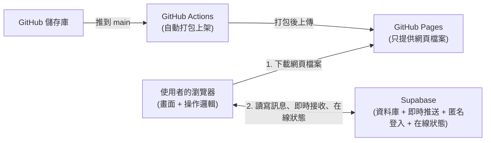
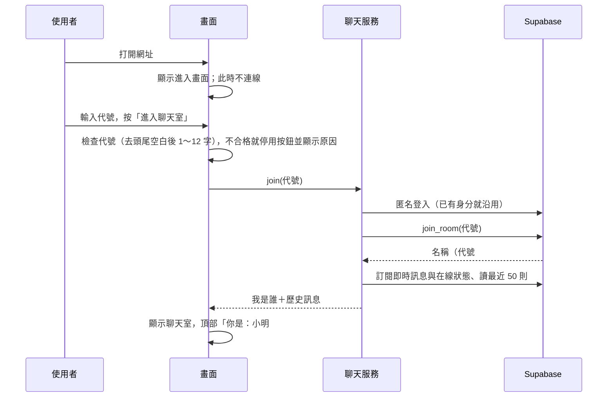
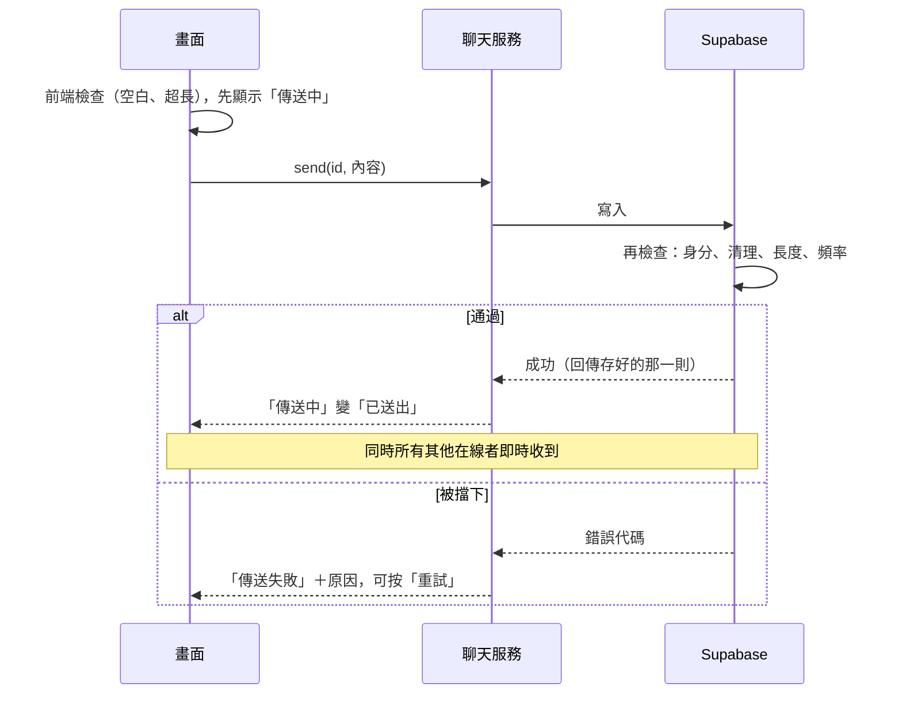

# 匿名聊天室 2：架構文件

## 1. 專案說明與目標

一個不用註冊登入的**匿名聊天室**，所有人在同一個聊天室裡。打開網址 → 輸入代號 → 按「進入聊天室」→ 進到共用大廳，可以看到大家的訊息，也可以發言。

目標：
1. 真的能用、能公開分享網址。
2. 完全免費運行（GitHub Pages 與 Supabase 免費方案）。
3. 分兩個階段：先做出不接後端的畫面（階段一），再接上 Supabase（階段二），第二階段不需要把第一階段重寫。

| 項目 | 決定 |
|---|---|
| 形式 | 一個所有人共用的大廳，沒有分房間 |
| 身分 | 進入前輸入「代號」，名稱＝代號＋「#」＋資料庫產生的 3 碼編號（如「小明#371」），編號不能自己指定 |
| 歷史訊息 | 進入時看到最近 50 則，往上可載入更早的 |
| 訊息內容 | 純文字，1～500 字；發出後不能編輯、刪除 |
| 即時性 | 別人的訊息即時出現，不用重新整理 |
| 在線 | 顯示「N 人在線」，可展開名單，有人進出時顯示提示 |
| 防濫用 | 只做發送頻率限制 |

## 2. 整體架構



重點：GitHub Pages 與 Supabase 彼此不認識；瀏覽器先拿到網頁，之後所有聊天資料直接找 Supabase。GitHub Pages 不能放秘密，所以**所有規則的把關都做在 Supabase 的資料庫**，前端的檢查只是讓使用者即時看到原因。

## 3. 技術選擇與理由

| 項目 | 選擇 | 理由 |
|---|---|---|
| 語言 | TypeScript | 資料格式（訊息、名單）有型別檢查，寫錯會提前警告 |
| 打包工具 | Vite | 設定少、速度快，輸出純靜態檔案，正好適合 GitHub Pages |
| 畫面 | 原生 DOM（不用框架） | 畫面只有兩個頁面與一個訊息列表，不需要框架；檔案小，載入快 |
| 後端 | Supabase | 一次提供資料庫（Postgres）、即時推送（Realtime）、匿名登入、在線狀態（Presence）、廣播（Broadcast，用於「正在輸入」），且有免費方案 |
| 部署 | GitHub Pages + GitHub Actions | 免費，推到 main 就自動上架 |

## 4. 兩個階段，以及如何避免重寫

**階段一（假後端）**：不接 Supabase，用 `src/mock.ts`。訊息存在瀏覽器的 localStorage，同一瀏覽器的分頁用 BroadcastChannel 互傳；預先放 60 則範例訊息；機器人偶爾發言、隨機進出；頻率限制、清理規則在假後端裡做同樣的實作。畫面上有「展示模式」提示。

**階段二（接 Supabase）**：改用 `src/room.ts`。

**插座設計**：畫面（`src/main.ts`）只透過 `src/service.ts` 的 `RoomService` 介面說話（指令：`join`、`older`、`send`、`notifyTyping`、`leave`；事件：`onPost`、`onMembers`、`onNotice`、`onStatus`、`onTyping`）。兩個階段各實作一次這個介面，由環境變數 `VITE_CHAT_MODE` 決定用哪一個（`live`＝Supabase，其他＝假後端）。所以從階段一到階段二，畫面一行都不用改。

**階段一在 GitHub Pages 上怎麼看到**：`pages.yml` 平常（推到 `main`）部署 `live` 模式。要在 Pages 上放可操作的展示模式，到儲存庫 Actions → Deploy to GitHub Pages → **Run workflow**，把 `chat_mode` 選成 `demo` 再執行，打包時不連 Supabase，網頁上會顯示「展示模式」提示。要換回正式版，再用 `live` 執行一次（或再推一次 `main`）。本機只要不設定 `VITE_CHAT_MODE`（或設成 `demo`）執行 `npm run dev`，就是展示模式。

## 5. 訊息資料格式

| 欄位 | 說明 | 規則 |
|---|---|---|
| `id` | 訊息編號（UUID），前端送出時先產生，用來避免同一則顯示兩次 | UUID |
| `user_id` | 發言者的匿名編號，由資料庫填 | 非空字串 |
| `nickname` | 發言者名稱（代號#編號），由資料庫填 | 1～20 字 |
| `body` | 內容 | 1～500 字純文字 |
| `created_at` | 時間，以伺服器為準 | 可解析的時間 |

收到的訊息先檢查這些欄位（`parsePost`），不合格就丟棄（只在 Console 留一行警告），通過後才以**純文字**顯示。

## 6. 資料流

### 6.1 進入聊天室



### 6.2 送出訊息



### 6.3 離開與在線人數
按「離開」或關閉分頁時，先取消在線登記（`untrack`）再停止接收，其他人的名單與人數立即更新並顯示「某某 離開了」。直接斷網或當機靠 Presence 的逾時機制，可能延遲數秒到數十秒。

### 6.4 斷線重連
斷線時顯示「重新連線中…」；恢復後用最後一則的時間補抓錯過的訊息（以 id 去除重複）。超過 60 秒仍沒恢復，回到進入畫面並提示重試。

## 7. 畫面清單

| 畫面 | 元素與行為 |
|---|---|
| 進入畫面（第一個看到） | 標籤「代號」、輸入框 `id="alias"`（最多 12 字）、按鈕「進入聊天室」（在 `<form>` 裡，Enter 也能送出）。代號不合格時按鈕停用並顯示原因。按下之前不連線 |
| 聊天室：頂部 | 標題、「N 人在線」（點開是在線名單，自己標「（你）」）、「你是：代號#編號」、「離開」按鈕 |
| 聊天室：提示 | 有人進來／離開的提示（6 秒，可疊加最多 3 則）；斷線時顯示「重新連線中…」 |
| 聊天室：訊息區 | 舊的在上、新的在下；自己的靠右，顯示「傳送中／已送出／傳送失敗＋重試」；最上方「載入更早的訊息」，載完顯示「已經是最早的訊息」，失敗可重試；沒有訊息時顯示「還沒有人說話，來打個招呼吧」 |
| 聊天室：正在輸入 | 輸入區上方一行「某某 正在輸入…」（2 人顯示兩個名字，3 人以上顯示「某某 等 N 人正在輸入…」）；5 秒沒更新或對方送出訊息就消失；固定佔一行高度，版面不會跳動 |
| 聊天室：輸入區 | 多行輸入框（電腦 Enter 送出、Shift+Enter 換行）、字數「N / 500」、送出鈕；被頻率限制時顯示「發言太快了，請稍等幾秒」 |

手機與電腦同一套畫面自動調整，無橫向捲軸。

## 8. 金鑰

| 東西 | 能不能公開 | 放哪裡 |
|---|---|---|
| Project URL | 可以 | 本機 `.env.local`；GitHub Actions 的 Secrets（`VITE_SUPABASE_URL`） |
| publishable key（可公開金鑰） | 可以（它本來就會出現在打包後的網頁裡，權限靠資料庫 RLS 限制） | 本機 `.env.local`；GitHub Actions 的 Secrets（`VITE_SUPABASE_PUBLISHABLE_KEY`） |
| secret key / service_role / 資料庫密碼 | **絕對不可以公開** | 本專案完全不使用、不取得、不寫進任何檔案 |

`.env`、`.env.local` 已列在 `.gitignore`，只有假值的 `.env.example` 會被 commit。

## 9. 安全與限制

| 可能的問題 | 前端 | 資料庫（真正的防線） |
|---|---|---|
| 空訊息、全空白 | 送出鈕停用 | 清理後長度必須 ≥ 1 |
| 超長訊息 | 字數計數、超過停用 | 長度必須 ≤ 500 |
| 夾帶 `<script>` 等網頁程式碼（XSS） | 訊息一律用 `textContent` 當純文字顯示 | 資料只當文字存放 |
| 洗版 | 送出前提示 | trigger：每人 10 秒最多 5 則、間隔 ≥ 0.5 秒 |
| 隱形或控制字元、大量空行 | 送出前過濾 | trigger 同樣移除、空行最多一個 |
| 假冒他人名稱 | 不讓使用者填完整名稱 | 名稱由資料庫依登入身分填，請求中帶的一律忽略 |
| 修改或刪除別人的訊息 | 沒有這個功能 | 不開放任何更新、刪除權限 |
| 收到格式不對的訊息 | `parsePost` 檢查欄位型別與長度，不合格丟棄 | 欄位本身有型別與長度限制 |
| 未登入直接讀寫 | — | 沒有匿名身分的請求被 RLS 拒絕 |

**已知限制**
- 代號可以重複（編號不同），單看代號可能混淆或冒用。
- 在線名單裡別人的名稱來自對方的瀏覽器，惡意使用者繞過網頁可以掛別的名字（不影響訊息上的名稱）；前端只檢查格式。
- 「正在輸入」訊號由各瀏覽器自己送出，沒有驗證來源，惡意使用者可以冒用別人的名稱；每個訊號都計入 Supabase 免費額度，所以送出端節流為每 3 秒最多一次。
- 訊息永久保存，容量長期會增長；畫面一次只載入 50 則。
- Supabase 免費方案：同時連線與每月即時訊息數有上限；專案閒置約一週會被暫停。

## 10. 這一版刻意不做的事

多個房間、私訊、編輯與刪除訊息、圖片與檔案、檢舉與封鎖、管理員後台、訊息自動清除、推播通知、完整帳號制。

## 11. 資料夾結構

```
├─ index.html                進入畫面與聊天室的 HTML
├─ src/
│  ├─ main.ts                畫面：只透過 RoomService 說話
│  ├─ service.ts             介面 RoomService 與選擇用哪個實作
│  ├─ mock.ts                階段一：假後端（localStorage）
│  ├─ room.ts                階段二：Supabase
│  ├─ rules.ts               規則：清理、檢查、parsePost、頻率限制
│  └─ style.css
├─ supabase/schema.sql       資料表、RLS、函式、trigger 的 SQL（手動貼到後台執行）
├─ docs/requirements.md      需求說明
├─ docs/architecture.md      本文件
├─ .github/workflows/pages.yml  自動打包部署
├─ .env.example              環境變數範本（假值）
└─ README.md
```

## 12. 部署到 GitHub Pages

1. 儲存庫 Settings → Pages，Source 選 **GitHub Actions**。
2. Settings → Secrets and variables → Actions，新增 `VITE_SUPABASE_URL`、`VITE_SUPABASE_PUBLISHABLE_KEY`。
3. 推到 `main`，`pages.yml` 會設定 `VITE_BASE`（儲存庫名稱當子路徑）與 `VITE_CHAT_MODE=live`，打包後上架。
4. 展示模式（階段一）：Actions → Deploy to GitHub Pages → Run workflow → `chat_mode` 選 `demo`。
5. Supabase 後台：Authentication → 打開 Allow anonymous sign-ins；SQL Editor 貼上 `supabase/schema.sql` 的內容執行。

## 13. 驗證清單

### 階段一（假後端，展示模式）
- [ ] 打開網址第一個看到進入畫面（有「代號」標籤與輸入框、「進入聊天室」按鈕），尚未連線，並看到「展示模式」提示
- [ ] 代號空白或超過 12 字：按鈕停用並顯示原因；合格代號可按 Enter 進入
- [ ] 進入後頂部「你是：代號#三碼」；重新整理再進入，編號不變
- [ ] 看到最近 50 則歷史訊息；往上按「載入更早的訊息」可載入，載完顯示「已經是最早的訊息」
- [ ] 送出訊息：「傳送中」→「已送出」，只顯示一次
- [ ] 快速連發出現「發言太快了」
- [ ] 貼上 `<b>粗體</b>`：原樣顯示為文字
- [ ] 機器人發言前，輸入區上方先出現「某某 正在輸入…」；機器人訊息自動進來；在線名單展開可看到自己（你）與其他人，有人進出時出現提示
- [ ] 按「離開」回到進入畫面，可換代號再進入
- [ ] 手機寬度無橫向捲軸

### 階段二（接上 Supabase）
- [ ] 第一次進入得到「代號#編號」，同一瀏覽器再進入編號不變；換瀏覽器編號不同
- [ ] 兩個不同瀏覽器互傳訊息，1～2 秒內出現，不用重新整理
- [ ] 在線名單互相看得到對方；對方進來／離開時看到提示；按「離開」後對方人數馬上減少
- [ ] 一邊打字，另一邊看到「某某 正在輸入…」，停止約 5 秒後消失；對方送出時立刻消失；自己看不到自己的
- [ ] 往上載入更早的訊息（訊息超過 50 則才會出現按鈕）、傳送失敗可重試
- [ ] 繞過網頁直接送 501 字、空白訊息、偽造名稱：被拒絕或名稱仍由資料庫填
- [ ] 短時間狂發被擋下，顯示「發言太快了」
- [ ] 未登入直接讀寫被拒絕；沒有任何方式修改或刪除訊息
- [ ] 斷網再恢復：顯示重連中，恢復後補齊訊息、無重複；超過 60 秒回到進入畫面
- [ ] 網頁與 Git 歷史中只有 Project URL 與 publishable key，沒有 secret key
